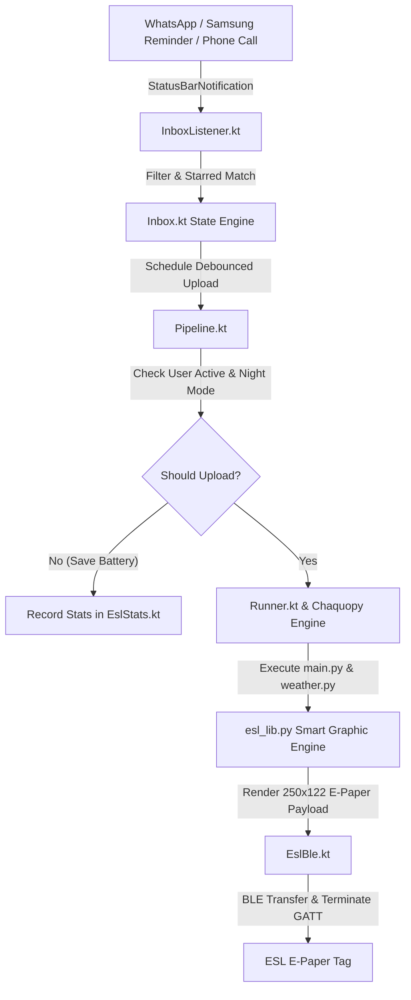

# 🏷️ Smart ESL E-Paper Tag Android Bridge

[](https://developer.android.com)
[](https://chaquo.com/chaquopy/)
[](https://bluetooth.com)
[](LICENSE)

A powerful, intelligent Android background bridge and Python graphic engine for 2.4-inch 4-color (Black, White, Yellow, Red) Electronic Shelf Label (ESL) E-Paper Displays. Transforms passive e-paper tags into real-time desk dashboards for live weather forecasts, incoming WhatsApp messages, Samsung Reminders, and call alerts.

---

## 📸 Display Modes & Preview Examples

```
 ┌──────────────────────────────────────────────┐
 │ Herzliya                         14:30 ☀️    │
 │                                              │
 │    ⛅ 24°          Feels 25°  UV 6           │
 │    H 26° L 18°     Wind 12km/h NW  Hum 60%    │
 │ ──────────────────────────────────────────── │
 │  Sun 06:12 - 18:45                           │
 │  ||||||||||||||||||||||||||||||||||||||||||  │
 │  12   15   18   21   00   03   06   09   12  │
 └──────────────────────────────────────────────┘
            [ Full Weather Screen ]
```

```
 ┌──────────────────────────┬───────────────────┐
 │ Messages           14:30 │ Herzliya    14:30 │
 │ Gali Smi..           [1] │ ⛅ 24°  Feels 25°   │
 │ Hey! Are we meeting      │ H 26° L18°  UV 6    │
 │ today at 5pm?            │ W 12km NW   H 60% │
 │                          │ Sun 06:12 - 18:45 │
 │                          │ ||||||||||||||||| │
 │ Missed: Mom 14:15        │ 12 15 18 21 00 03 │
 └──────────────────────────┴───────────────────┘
   [ Split View: Fluid Messages + Compact Weather ]
```

```
 ┌──────────────────────────────────────────────┐
 │ INCOMING CALL                          14:30 │
 │                                              │
 │               📞 Gali Smith                   │
 │                                              │
 │ ════════════════════════════════════════════ │
 │                WhatsApp Call                 │
 └──────────────────────────────────────────────┘
            [ Full-Screen Incoming Call ]
```

---

## ✨ Features & Highlights

- **📐 Fluid Adaptive Messaging Layout:** Messages scale dynamically! Single messages expand up to 4 lines of content snippet.
- **🌤️ Rich Split View & Compact Weather:** Messages never push weather away completely — compact weather sits side-by-side with 100% of weather stats (Icon, Temp, High/Low, Feels Like, UV, Wind, Humidity, Sunrise/Sunset, 6-Hour Rain Bar Chart).
- **🇮🇱 Native Bi-Directional Hebrew Support:** Full right-to-left Hebrew shaping and mixed Hebrew + English token reordering.
- **😊 System Emoji Rendering:** Auto-detects Android system emoji fonts (`NotoColorEmoji.ttf`) for crisp emoji display without missing glyph boxes (`□`).
- **📱 Smart Phone Battery & User-Active Protection:**
  - **Screen-On Saver:** Automatically skips BLE uploads when you are actively using your phone to prevent unnecessary tag flashes and conserve battery.
  - **Night Quiet Mode:** Configurable quiet hours (e.g. 23:00 - 07:00) during which updates are paused.
  - **GATT Termination:** Explicitly terminates and closes Bluetooth GATT connections after transfers to free hardware radio resources.
- **⭐ Favorite Contacts Auto-Accept:** Automatically matches notifications from Starred / Favorite contacts in your phone's address book.
- **🔔 Multi-App Notifications:** Supports WhatsApp, WhatsApp Business, and Samsung Reminders.
- **📊 Real-Time Telemetry & Statistics:** Tracks messages received, display changes performed, and saved uploads.

---

## 🛠️ Architecture Overview



---

## ⚙️ Configuration Reference (`config.json`)

Edits in `config.json` apply instantly without rebuilding the app:

| Parameter | Type | Default | Description |
| :--- | :--- | :--- | :--- |
| `"people"` | Array | `["gali", "mom"]` | List of contact names/substrings to follow (`["*"]` for all). |
| `"show_text"` | Boolean | `true` | Show message snippet text. |
| `"chat_delay_s"` | Int | `2` | Delay before uploading new messages to tag. |
| `"chat_min_gap_s"` | Int | `10` | Minimum seconds between two BLE uploads. |
| `"weather_return_s"`| Int | `60` | Delay in seconds before returning to full weather after messages are cleared. |
| `"chat_timeout_m"` | Int | `30` | Expiration time in minutes after which unread messages revert to weather. |
| `"show_calls"` | Boolean | `true` | Toggle full-screen incoming call cards. |
| `"show_messages"` | Boolean | `true` | Toggle WhatsApp / Reminder message display. |
| `"show_favorites"` | Boolean | `true` | Auto-accept notifications from Starred/Favorite contacts. |
| `"compact_weather"` | Boolean | `true` | Enable split-screen messages + compact weather. |
| `"name_max_len"` | Int | `8` | Maximum length for contact names on screen. |
| `"night_quiet_mode"`| Boolean | `true` | Pause BLE updates during night hours. |
| `"night_start_hour"`| Int | `23` | Night mode start hour (23:00). |
| `"night_end_hour"` | Int | `7` | Night mode end hour (07:00). |

---

## 🚀 Getting Started

1. Open the project in **Android Studio**.
2. Build and run on an Android phone (API 31+).
3. Grant permissions: **Bluetooth**, **Notification Access** (Settings > Notification Access > ESL Tag), **Contacts**, and **Calls**.
4. Tap **"Pair tag"** in the app to pair your ESL tag address (`14:20:10:19:39:37`).
5. Tap **"Run now"** to render and test your first display upload!

---

## 📄 License

Distributed under the **MIT License**.
